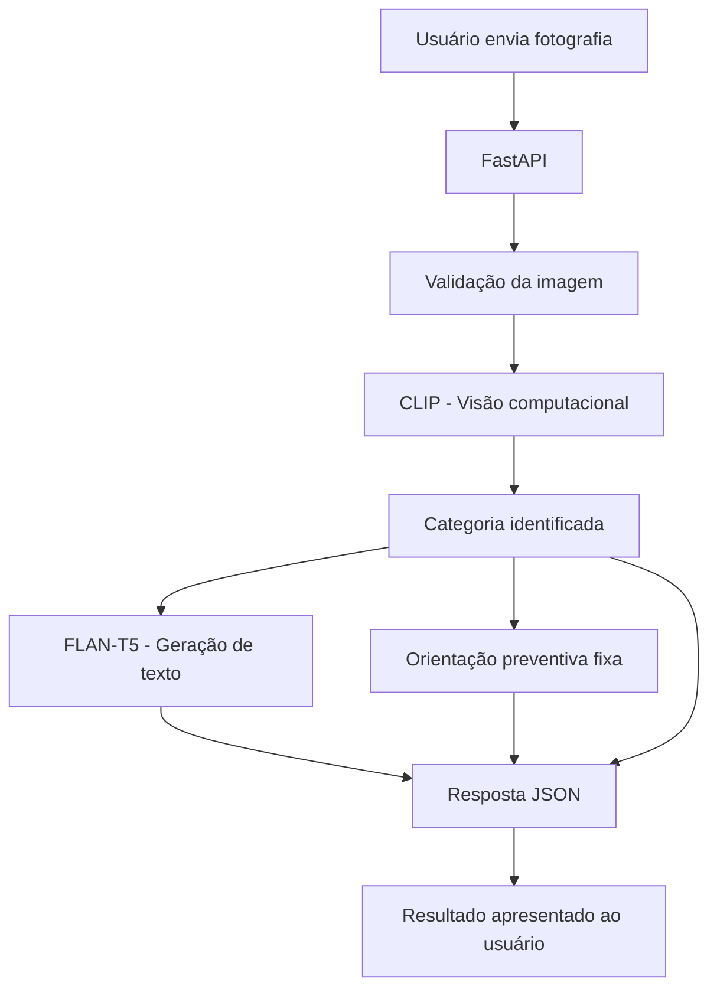

# 🚨 AlertaCom-IA

## 📌 Sobre o projeto

O **AlertaCom-IA** é um projeto acadêmico desenvolvido para auxiliar na identificação de incidentes urbanos utilizando inteligência artificial, visão computacional e IA generativa.

A aplicação permite que o usuário envie uma fotografia de uma situação urbana. O sistema analisa a imagem, identifica a categoria mais compatível e retorna orientações relacionadas ao incidente.

O objetivo é demonstrar como a inteligência artificial pode apoiar iniciativas de cidades inteligentes, contribuindo para a identificação e comunicação de problemas urbanos.

## 🎯 Objetivos

- Identificar incidentes urbanos por meio de fotografias.
- Classificar imagens utilizando visão computacional.
- Integrar um modelo de IA generativa à aplicação.
- Disponibilizar uma API REST para análise de imagens.
- Fornecer orientações preventivas relacionadas aos incidentes.
- Avaliar os resultados, as limitações e os riscos dos modelos utilizados.

## 🛠️ Tecnologias utilizadas

| Tecnologia | Finalidade |
|---|---|
| Python | Desenvolvimento da aplicação |
| FastAPI | Construção da API REST |
| Swagger UI | Documentação e testes dos endpoints |
| PyTorch | Execução dos modelos de inteligência artificial |
| Hugging Face Transformers | Carregamento dos modelos |
| CLIP | Classificação de imagens |
| FLAN-T5 Small | Geração de texto |
| Pillow | Leitura e validação de imagens |
| Google Gemini | Integração experimental anterior |

## 🧠 Modelos de inteligência artificial

### 1. CLIP — Visão computacional

O projeto utiliza o modelo `openai/clip-vit-base-patch32`, executado localmente.

O CLIP relaciona imagens e descrições textuais. No AlertaCom-IA, ele compara a fotografia enviada com descrições em inglês associadas às categorias disponíveis.

A categoria com maior pontuação relativa é selecionada.

**Categorias reconhecidas:**

| Categoria | Descrição |
|---|---|
| `ALAGAMENTO` | Ruas alagadas |
| `BUEIRO_OBSTRUIDO` | Bueiros obstruídos |
| `ARVORE_CAIDA` | Árvores caídas em vias públicas |
| `BURACO_NA_VIA` | Buracos no asfalto |
| `SEM_INCIDENTE` | Ruas sem incidentes evidentes |

**Justificativa técnica:** o CLIP foi escolhido por permitir classificação de imagens com descrições textuais, utilizando um modelo previamente treinado, sem exigir treinamento de uma rede neural do zero.

A pontuação relativa indica a preferência entre as categorias avaliadas, mas não representa uma probabilidade calibrada de acerto.

### 2. FLAN-T5 Small — IA generativa

O projeto também utiliza o modelo `google/flan-t5-small`, executado localmente.

O FLAN-T5 é um modelo generativo de linguagem baseado na arquitetura Transformer.

Após a classificação da imagem, o sistema envia ao FLAN-T5 uma descrição textual da situação identificada, solicitando a geração de uma orientação em inglês.

**Justificativa técnica:** o FLAN-T5 foi escolhido para demonstrar a integração de IA generativa ao fluxo da aplicação, com execução local e sem dependência obrigatória de uma API externa.

Os textos gerados são experimentais e não são considerados recomendações de segurança validadas.

### 3. Orientações preventivas em português

Além do texto produzido pelo FLAN-T5, a aplicação retorna uma orientação fixa em português, associada à categoria identificada.

Essas orientações são mantidas separadas das respostas geradas, reduzindo a dependência de conteúdos potencialmente incorretos da IA generativa.

Elas são recomendações gerais e não substituem orientações de órgãos públicos, serviços de emergência ou profissionais responsáveis.

## 🏗️ Arquitetura da solução



**Fluxo de processamento:**

1. O usuário envia uma fotografia pelo endpoint `/analyze-incident`.
2. A API verifica o tipo, tamanho e integridade do arquivo.
3. O CLIP compara a imagem com descrições das categorias disponíveis.
4. A categoria mais compatível é selecionada.
5. O FLAN-T5 recebe uma descrição textual da categoria e gera uma frase em inglês.
6. O sistema recupera a orientação preventiva fixa correspondente.
7. A API retorna a classificação e as orientações em formato JSON.

## 🔌 Endpoints da API

### GET `/`

Retorna informações básicas sobre o projeto.

### GET `/health`

Verifica se a API está respondendo.

**Exemplo:**

```json
{
  "status": "online"
}
```

### POST `/analyze-incident`

Recebe uma fotografia e executa o fluxo de classificação e geração de texto.

**Entrada:** arquivo de imagem enviado como `multipart/form-data`.

**Limite:** 5 MB por arquivo.

**Exemplo de resposta observada durante os testes:**

```json
{
  "imagem_valida": true,
  "modo": "CLIP_LOCAL",
  "categoria": "ALAGAMENTO",
  "pontuacao_relativa": 0.9977,
  "modelo": "openai/clip-vit-base-patch32",
  "orientacao": {
    "orientacao_gerada": "The street is closed.",
    "idioma_gerado": "en",
    "orientacao_segura": "Não atravesse áreas alagadas. Procure uma rota segura.",
    "modo": "FLAN_T5_LOCAL"
  }
}
```

O campo `orientacao_gerada` contém a saída experimental da IA generativa. O campo `orientacao_segura` contém a orientação preventiva fixa em português.

## 🧪 Testes e avaliação

Foram realizados testes manuais com cinco fotografias representando situações urbanas diferentes.

As imagens estão armazenadas na pasta `testes/`.

### Resultados da classificação

| Imagem | Categoria esperada | Categoria obtida | Pontuação relativa | HTTP |
|---|---|---|---:|---|
| Alagamento | ALAGAMENTO | ALAGAMENTO | 0,9977 | 200 |
| Árvore caída | ARVORE_CAIDA | ARVORE_CAIDA | 0,9995 | 200 |
| Bueiro obstruído | BUEIRO_OBSTRUIDO | BUEIRO_OBSTRUIDO | 0,9092 | 200 |
| Buraco na via | BURACO_NA_VIA | BURACO_NA_VIA | 0,9997 | 200 |
| Rua normal | SEM_INCIDENTE | SEM_INCIDENTE | 0,9890 | 200 |

**Resultado observado:** cinco classificações corretas em cinco imagens avaliadas.

A taxa de acerto nesse pequeno conjunto foi de 100%.

Esse resultado não comprova precisão geral de 100%, pois a amostra é pequena, não é representativa de todos os ambientes urbanos e foi utilizada durante o desenvolvimento.

### Avaliação da IA generativa

| Situação | Resposta gerada pelo FLAN-T5 | Avaliação |
|---|---|---|
| Alagamento | The street is closed. | Genérica |
| Árvore caída | Keep your eyes open. | Pouco específica |
| Bueiro obstruído | The drain is closed. | Descritiva |
| Buraco na via | The pothole is a large hole. | Descritiva |
| Rua normal | The street is closed. | Inadequada |

O FLAN-T5 gerou texto legível nas cinco requisições, mas não produziu recomendações preventivas suficientemente específicas.

No teste com a rua normal, o modelo gerou uma afirmação inadequada, demonstrando o risco de respostas incorretas.

**Conclusão da avaliação:** a integração técnica entre visão computacional e IA generativa está funcionando, mas a qualidade das orientações geradas precisa ser aprimorada antes de qualquer utilização prática.

### Critérios de avaliação

Foram considerados:

- Correspondência entre a categoria esperada e a categoria identificada.
- Retorno HTTP 200 nas requisições válidas.
- Presença dos campos esperados no JSON.
- Execução da geração de texto pelo FLAN-T5.
- Pertinência e utilidade das respostas geradas.
- Identificação de limitações e possíveis respostas inadequadas.

## ▶️ Como executar o projeto

### 1. Clonar o repositório

```bash
git clone https://github.com/matheus-molina/AlertaCom-IA.git
cd AlertaCom-IA
```

### 2. Criar o ambiente virtual

```bash
python -m venv .venv
```

### 3. Ativar o ambiente virtual

No Windows PowerShell:

```powershell
.\.venv\Scripts\Activate.ps1
```

### 4. Instalar as dependências

```bash
python -m pip install -r requirements.txt
```

### 5. Iniciar o servidor

```bash
python -m uvicorn src.main:app --reload
```

### 6. Acessar o Swagger

Abra no navegador:

http://127.0.0.1:8000/docs

Selecione `POST /analyze-incident`, clique em **Try it out**, envie uma fotografia e execute a análise.

**Observação:** na primeira execução, os modelos CLIP e FLAN-T5 podem precisar baixar arquivos do Hugging Face. É necessária conexão com a internet para esse download inicial. O processamento local também exige memória e recursos computacionais compatíveis.

## 📁 Estrutura do projeto

```text
AlertaCom-IA/
├── src/
│   ├── main.py
│   ├── vision_classifier.py
│   ├── clip_classifier.py
│   └── generative_advisor.py
├── testes/
│   ├── alagamento.jpeg
│   ├── arvore.jpeg
│   ├── Bueiro obstruído.jpeg
│   ├── Buraco na rua.webp
│   └── Rua normal.avif
├── teste_clip.py
├── teste_flan.py
├── teste_gemini.py
├── requirements.txt
├── README.md
├── .gitignore
└── .env
```

O arquivo `.env` contém configurações locais e não deve ser enviado ao repositório. O ambiente `.venv` também não deve ser versionado.

## ⚠️ Limitações e responsabilidade

- O CLIP classifica imagens apenas entre as categorias configuradas.
- As pontuações relativas não são probabilidades calibradas.
- A análise depende das descrições textuais utilizadas.
- O conjunto de testes é pequeno e não representa a diversidade de cenários reais.
- O FLAN-T5 pode gerar frases genéricas, incorretas ou inadequadas.
- A saída generativa não é validada automaticamente.
- O sistema não determina a gravidade dos incidentes.
- Uma fotografia isolada não permite garantir a segurança de uma área.
- O projeto é um protótipo acadêmico e não deve ser utilizado como sistema oficial de emergência.
- Fotografias podem conter pessoas, placas e outras informações sensíveis; recomenda-se evitar o envio de imagens com dados pessoais desnecessários.

## 🔬 Experimentos com Google Gemini

Durante o desenvolvimento, também foi explorada a integração com a API Google Gemini.

Nos testes, ocorreram erros de timeout `504 DEADLINE_EXCEEDED`, impedindo a utilização consistente dessa integração.

Como alternativa, foram adotados modelos executados localmente:

- CLIP, para classificação visual.
- FLAN-T5 Small, para geração de texto.

O arquivo experimental de integração com Gemini foi mantido para fins de estudo e documentação das tentativas realizadas.

## 🔐 Segurança e reprodutibilidade

- Credenciais de API devem permanecer em variáveis de ambiente.
- O arquivo `.env` não deve ser versionado.
- A pasta `.venv` deve permanecer fora do repositório.
- As dependências devem estar registradas no `requirements.txt`.
- Os modelos utilizados são identificados pelos respectivos nomes.
- A API valida o formato, a integridade e o tamanho dos arquivos recebidos.

## 🎓 Contexto acadêmico

Projeto desenvolvido para a **Global Solution da FIAP**, no contexto da proposta **CitizenTech**, com foco na utilização de inteligência artificial para problemas urbanos.

**Instituição:** FIAP

**Curso:** Análise e Desenvolvimento de Sistemas

**Turma:** 2TDSR

**Integrantes:** preencher com os nomes completos e RMs de todos os participantes antes da entrega.

**Repositório:** https://github.com/matheus-molina/AlertaCom-IA